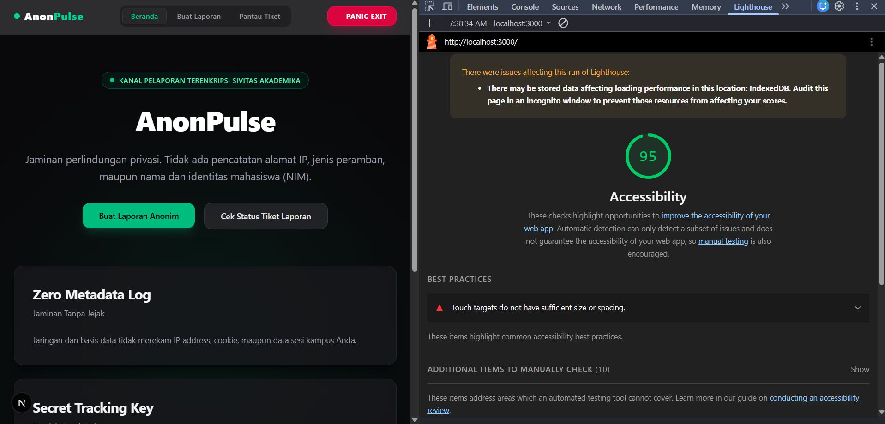
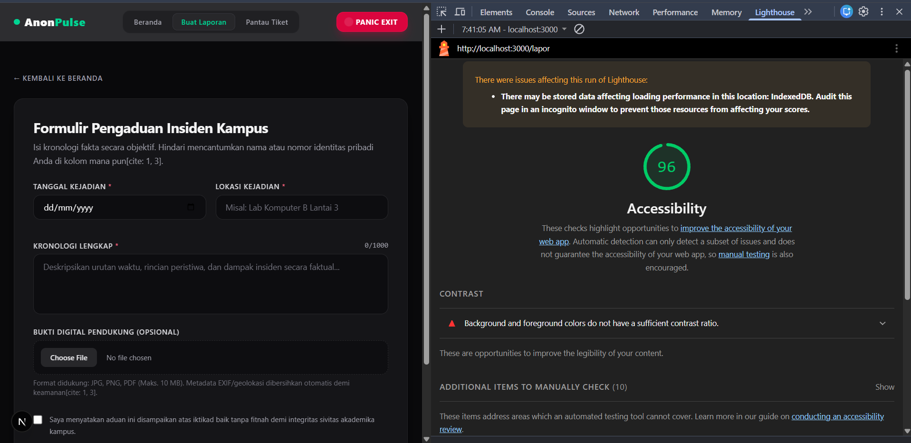
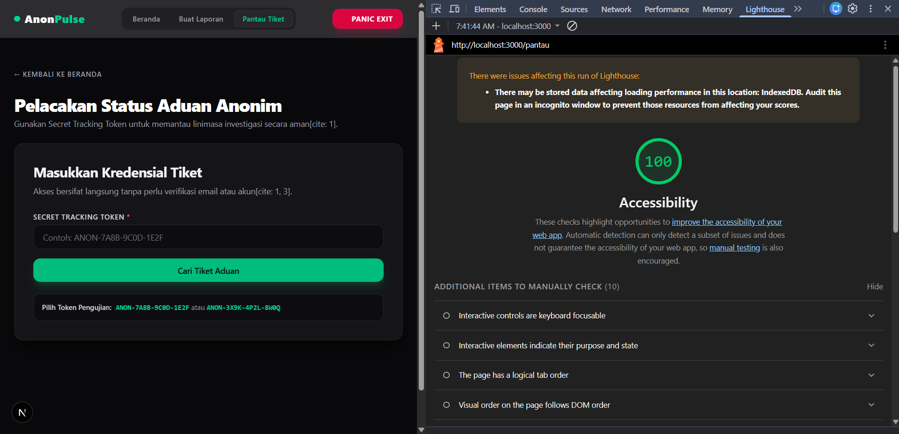

# AnonPulse - Platform Pelaporan Kampus Terenkripsi & Anonim

AnonPulse adalah kanal pelaporan insiden kampus (kekerasan seksual, perundungan, intimidasi, dan pelanggaran etik) yang dibangun dengan pendekatan _trauma-informed design_ dan prinsip privasi ketat (_Zero-PII_). Sistem memastikan tidak ada data identitas pelapor yang direkam oleh institusi.

---

## 1. Konsep Produk

- **Nama Produk:** AnonPulse
- **Latar Belakang & Permasalahan:**  
  Banyak korban dan saksi di lingkungan kampus memilih bungkam karena relasi kuasa pelaku, ancaman akademik, serta kekhawatiran atas bocornya data pribadi (_Personally Identifiable Information_ / PII) pada formulir pengaduan institusi standar.
- **Tujuan Produk:**  
  Menyediakan kanal pelaporan mandiri yang menjamin kerahasiaan identitas 100%, memutus ketergantungan pada akun institusi/SSO kampus, serta memberikan transparansi proses penanganan kasus oleh Satgas PPKS.
- **Sasaran Pengguna:**
  1. Sivitas akademika (Mahasiswa, Dosen, Tenaga Kependidikan) sebagai pelapor atau saksi insiden.
  2. Tim Satgas PPKS / Komisi Etik Kampus sebagai penindaklanjuti laporan.
- **Fungsi Utama Aplikasi Web:**
  1. _Pelaporan Esensial Tanpa Akun:_ Pelaporan langsung berbasis fakta (waktu kejadian, lokasi spesifik, kronologi bebas, dan bukti lampiran) tanpa proses _login_ atau verifikasi identitas.
  2. _Sistem Pelacakan Tiket Rahasia (Secret Tracking Token):_ Penerbitan token acak 16-karakter ramah manusia sebagai satu-satunya kredensial pelapor untuk memantau status tindak lanjut tanpa meninggalkan rekam jejak akun.
  3. _Mekanisme Darurat (Trauma-Informed Panic Exit):_ Tombol keluar instan pada bilah navigasi atas yang membersihkan sesi peramban dan mengalihkan layar ke portal umum seketika.

---

## 2. Struktur Halaman Aplikasi

Aplikasi terdiri dari 3 halaman utama yang terintegrasi dalam satu alur penggunaan:

1. **Halaman Beranda (`/`)**  
   Pusat edukasi privasi, penjelasan jaminan _Zero-PII_, serta akses navigasi cepat menuju pembuatan aduan dan pemantauan tiket.
2. **Halaman Formulir Aduan (`/lapor`)**  
   Antarmuka formulir pengaduan dengan validasi sisi klien (_client-side validation_) ketat untuk tanggal kejadian, lokasi, kronologi minimal, dan format berkas pendukung.
3. **Halaman Pelacakan Kasus (`/pantau`)**  
   Portal pencarian laporan berbasis token acak yang terintegrasi dengan struktur _mock data_ linimasa penanganan Satgas.

---

## 3. Komponen Antarmuka Reusable

Direktori `src/components/` memuat komponen antarmuka modular yang dirancang sesuai standar aksesibilitas:

1. `Button` (`src/components/ui/Button.tsx`): Komponen tombol interaktif dengan ragam varian visual (_primary_, _secondary_, _danger_, _ghost_), transisi taktil, dan status _disabled_.
2. `InputField` (`src/components/ui/InputField.tsx`): Komponen input teks dan tanggal yang terikat atribut aksesibilitas (`aria-invalid`, `aria-describedby`, serta `role="alert"` untuk penanganan galat).
3. `TextareaField` (`src/components/ui/TextareaField.tsx`): Area input kronologi naratif yang dilengkapi dengan penghitung batas karakter interaktif.
4. `Card` (`src/components/ui/Card.tsx`): Kontainer modular dengan gaya _dark glassmorphism_ untuk membungkus blok informasi secara konsisten.
5. `Badge` (`src/components/ui/Badge.tsx`): Label penanda status investigasi (_TERKIRIM_, _INVESTIGASI_, _SELESAI_) dengan kode warna visual adaptif.
6. `Navbar` (`src/components/layout/Navbar.tsx`): Bilah navigasi terpadu yang menempel di bagian atas layar (_sticky header_), memuat tautan antarhalaman dan tombol _Panic Exit_.

---

## 4. Teknologi yang Digunakan

- **Kerangka Kerja (Framework):** Next.js 16 (App Router)
- **Bahasa Pemrograman:** TypeScript (Strict Mode)
- **Styling & Desain Antarmuka:** Tailwind CSS v4 (Dark Theme Palette: Zinc & Emerald Glow)
- **Penyimpanan Tiruan (Mock Data):** TypeScript Data Contract (`src/types/report.ts` & `src/data/mockReports.ts`)

---

## 5. Petunjuk Menjalankan Proyek

### Prasyarat

- Node.js versi 18.18.0 atau yang lebih baru.
- Pengelola paket `npm`.

### Langkah Instalasi

```bash
# 1. Klon repositori
git clone [https://github.com/username/anonpulse.git](https://github.com/username/anonpulse.git)

# 2. Masuk ke direktori proyek
cd anonpulse

# 3. Pasang paket dependensi
npm install

# 4. Jalankan server pengembangan lokal
npm run dev
```

# Laporan Pengujian Aksesibilitas Web (Google Lighthouse)

Dokumen ini memuat hasil pengujian aksesibilitas menggunakan Google Lighthouse pada platform AnonPulse untuk memenuhi ketentuan Milestone 1.

---

## 1. Kondisi Pengujian

- **Peramban (Browser):** Google Chrome Versi 130+ (Blink Engine)
- **Mode Pengujian:** Navigation (Default)
- **Kategori Pengujian:** Accessibility
- **Lingkungan Pengujian:** Server Lokal (`http://localhost:3000`)

---

## 2. Ringkasan Skor Aksesibilitas

| Halaman yang Diuji | Rute (URL) | Skor Lighthouse (Desktop) | Status Kepatuhan (Min. 85) |
| :----------------- | :--------- | :-----------------------: | :------------------------: |
| Halaman Beranda    | `/`        |         95 / 100          |         Terpenuhi          |
| Formulir Aduan     | `/lapor`   |         96 / 100          |         Terpenuhi          |
| Pelacakan Status   | `/pantau`  |         100 / 100         |         Terpenuhi          |

---

## 3. Aspek Aksesibilitas yang Diterapkan

1. **Struktur Semantik HTML5:**
   - Penggunaan elemen `<main>`, `<header>`, `<nav>`, `<section>`, dan `<article>` secara terstruktur.
   - Hanya ada satu judul utama level satu (`<h1>`) di setiap halaman untuk kemudahan navigasi pembaca layar (_screen reader_).

2. **Aksesibilitas Kontrol Formulir:**
   - Setiap elemen `<input>` dan `<textarea>` terhubung secara eksplisit dengan `<label>` menggunakan atribut `htmlFor` dan `id`.
   - Penanganan galat validasi menggunakan atribut `aria-invalid="true"` serta dihubungkan ke pesan error lewat `aria-describedby` dengan `role="alert"`.

3. **Kontras Warna (Contrast Ratio):**
   - Teks terang (`zinc-100` dan `white`) di atas latar gelap pekat (`zinc-950`) memenuhi batas rasio kontras WCAG AAA ($\ge 7:1$).
   - Tombol aksi utama aksen hijau (`emerald-500`) dan tombol keluar darurat (`rose-600`) memenuhi batas rasio kontras WCAG AA ($\ge 4.5:1$).

4. **Navigasi Keyboard & Focus Management:**
   - Seluruh elemen interaktif (tombol, tautan, kontrol form) memiliki indikator visual fokus (`focus:ring-2` / `focus:ring-emerald-400`).

---

# Bukti Tangkapan Layar (Screenshots)

- **Desktop Beranda**
  

- **Formulir Aduan**
  

- **Pelacakan Tiket**
  

---

### Pratinjau Tampilan Markdown di VS Code

Untuk memeriksa apakah format Markdown sudah rapi sebelum diunggah:

1. Saat membuka berkas `README.md`, tekan kombinasi tombol:
   - **Windows/Linux:** `Ctrl + K` lalu tekan `V` (atau tekan `Ctrl + Shift + V`).
   - **Mac:** `Cmd + K` lalu tekan `V`.
2. Tab pratinjau (_Markdown Preview_) akan terbuka di sebelah kanan editor untuk melihat rendering judul, tabel, dan blok kodenya.
3. Tekan `Ctrl + S` untuk menyimpan berkas.

---

### Simpan dan Unggah ke GitHub (Commit & Push)

Buka terminal terintegrasi di VS Code (`Ctrl + ~`), lalu jalankan baris perintah Git berikut:

```bash
# 1. Tambahkan berkas README ke staging
git add README.md

# 2. Buat catatan commit
git commit -m "docs: tambahkan dokumentasi komprehensif README Milestone 1"

# 3. Unggah ke repositori GitHub utama
git push origin main
```
