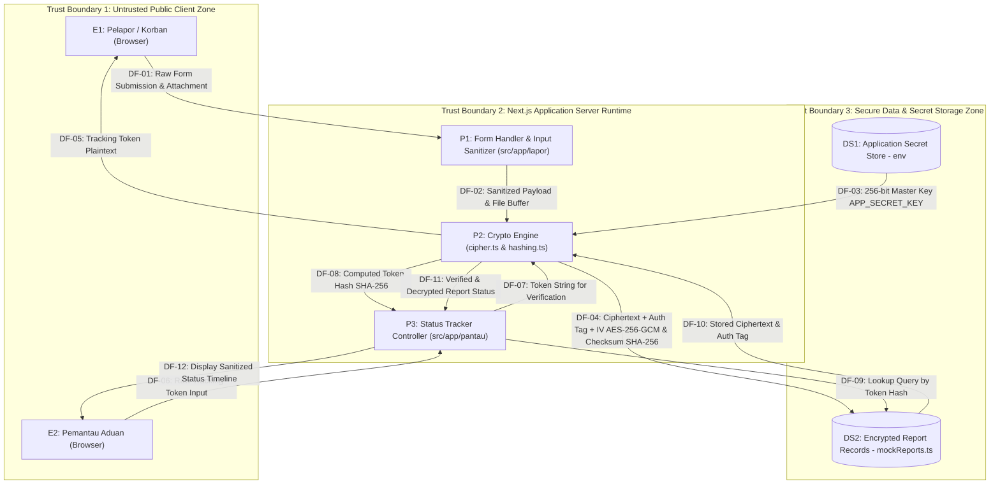

# Data Flow Diagram (DFD) Level-1 - AnonPulse

Diagram alir data berikut memetakan batasan kepercayaan (_trust boundary_), aliran data masuk/keluar, dan titik perlindungan kriptografi pada sistem AnonPulse.

### Visualisasi Diagram (Mermaid)

Struktur repositori AnonPulse Anda telah terverifikasi secara lengkap. File kode sumber inti (`cipher.ts`, `hashing.ts`, `mockReports.ts`, rute App Router, dan komponen UI) telah terpetakan dengan tepat sesuai arsitektur Next.js 16 dan Node native crypto.

Berikut adalah isi dokumen lengkap yang telah diselaraskan dengan struktur riil repositori Anda, siap disimpan dan di-commit untuk memenuhi seluruh butir penugasan.

---

### Keterangan Elemen DFD

1. **Entitas Eksternal (External Entities):**

- `E1`: Pelapor / Korban — Pengguna yang mengirimkan aduan via `/lapor`.
- `E2`: Pemantau Aduan — Pengguna yang meninjau tindak lanjut laporan via `/pantau`.

2. **Proses (Processes):**

- `P1`: Form Handler & Input Sanitizer — Memvalidasi isian form, memastikan tidak ada PII mentah, dan membatasi ukuran input.
- `P2`: Crypto Engine — Modul native crypto (`src/lib/crypto/cipher.ts` dan `hashing.ts`) yang mengeksekusi AES-256-GCM dan SHA-256 digest.
- `P3`: Status Tracker Controller — Menangani routing pelacakan status laporan berdasarkan token.

3. **Penyimpanan Data (Data Stores):**

- `DS1`: Application Secret Store — Penyimpanan environment variable server runtime untuk kunci enkripsi master.
- `DS2`: Encrypted Report Records — Media penyimpanan data aduan terlindungi enkripsi dan metadata hash.

4. **Batas Kepercayaan (Trust Boundaries):**

- **TB1 (Public/Untrusted Zone):** Lingkungan browser pengguna akhir yang rentan terhadap inspeksi fisik, cache lokal, dan serangan jaringan publik.
- **TB2 (Application Runtime Zone):** Proses internal Next.js server tempat logika bisnis dan operasi kriptografi dieksekusi.
- **TB3 (Storage/Secret Zone):** Zona isolasi data terenkripsi dan kunci rahasia internal.
