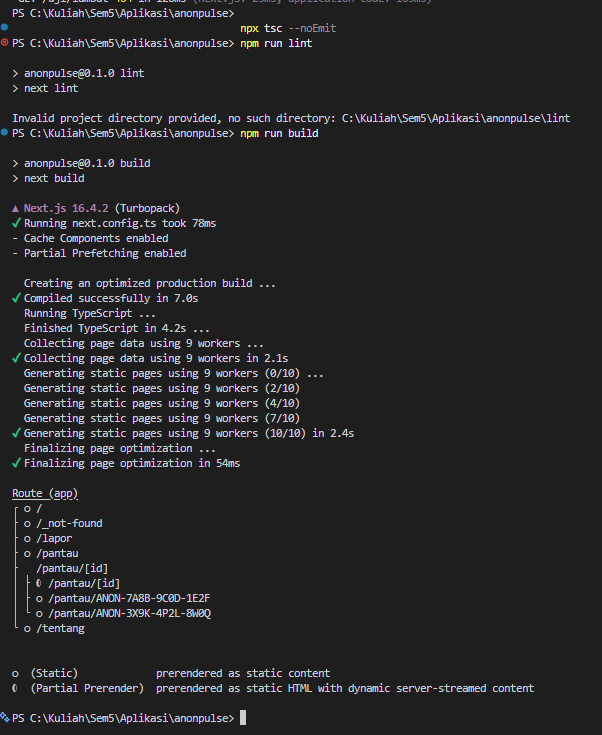

## 1. Peta Rute

| URL            | Berkas di `app/`               | Jenis Rute | Isi Halaman                                                            |
| :------------- | :----------------------------- | :--------- | :--------------------------------------------------------------------- |
| `/`            | `src/app/page.tsx`             | Statis     | Landing page, kartu fitur privasi, dan navigasi utama pelaporan anonim |
| `/tentang`     | `src/app/tentang/page.tsx`     | Statis     | Ringkasan platform, nilai privasi mutlak, dan enkripsi sisi klien      |
| `/pantau`      | `src/app/pantau/page.tsx`      | Statis     | Dashboard pemantauan tiket insiden dengan layout bersarang             |
| `/pantau/[id]` | `src/app/pantau/[id]/page.tsx` | Dinamis    | Halaman detail tiket terenkripsi, timeline investigasi, dan status     |
| `/lapor`       | `src/app/lapor/page.tsx`       | Statis     | Formulir pelaporan anonim terenkripsi                                  |

### Potongan Tabel Rute (npm run build)

```text
Route (app)                              Size     First Load JS
┌ ○ /                                    ... B          ... kB
├ ○ /_not-found                          ... B          ... kB
├ ○ /lapor                               ... B          ... kB
├ ○ /pantau                              ... B          ... kB
├ ● /pantau/[id]                         ... B          ... kB
│ ├ /pantau/ANON-7A8B-9C0D-1E2F
│ └ /pantau/ANON-3X9K-4P2L-8W0Q
└ ○ /tentang                             ... B          ... kB
+ First Load JS shared by all            ... kB
  ├ chunks/main-app-...
  └ chunks/...

○  (Static)   prerendered as static content
●  (SSG)      prerendered as static HTML (uses generateStaticParams)

```

## 2. Layout, Template, dan Berkas Khusus

### Pohon Folder `src/app/` Akhir

```text
src/app/
├── favicon.ico
├── globals.css
├── layout.tsx
├── not-found.tsx
├── page.tsx
├── lapor/
│   └── page.tsx
├── pantau/
│   ├── layout.tsx
│   ├── template.tsx
│   ├── loading.tsx
│   ├── error.tsx
│   ├── page.tsx
│   └── [id]/
│       ├── page.tsx
│       └── not-found.tsx
└── tentang/
    └── page.tsx

```

### Hasil Uji Layout vs Template

State pada komponen `KolomCatatan` di dalam `layout.tsx` tetap dipertahankan saat berpindah ke sub-halaman detail tiket (`/pantau/[id]`) dan kembali, sedangkan state pada `template.tsx` otomatis tereset kembali ke string kosong karena template menerima key unik yang memicu remount.


### Tangkapan Layar `loading.tsx` dan `error.tsx`

Pengujian dilakukan pada rute segmen `/uji/` (sebelum dihapus untuk build produksi).

- Fallback `loading.tsx` menampilkan UI berstatus aksesibel saat menunggu latensi buatan via `connection()`.
  
- Error boundary `error.tsx` menangkap kegagalan render Server Component dan menampilkan tombol retry.
  

## 3. Rute Dinamis dan Validasi params

### Tabel Uji URL dan Kode Status cURL

| URL Uji                                            | Hasil yang Diharapkan                     | Hasil Aktual                           | Kode Status cURL |
| -------------------------------------------------- | ----------------------------------------- | -------------------------------------- | ---------------- |
| `http://localhost:3000/pantau/ANON-7A8B-9C0D-1E2F` | Menampilkan detail tiket insiden lantai 3 | Detail tiket tampil sesuai data mock   | 200              |
| `http://localhost:3000/pantau/abc`                 | Memicu `notFound()` segmen                | Tampilan `Laporan Tidak Ditemukan`     | 404              |
| `http://localhost:3000/pantau/999999`              | Memicu `notFound()` segmen                | Tampilan `Laporan Tidak Ditemukan`     | 404              |
| `http://localhost:3000/tidak-ada`                  | Memicu `not-found.tsx` global             | Tampilan `404 Halaman tidak ditemukan` | 404              |


### Penjelasan Aturan Validasi params

Nilai parameter URL diterima melalui prop `params` bertipe `Promise<{ id: string }>` yang wajib diselesaikan dengan `await params`. Nilai parameter kemudian didekode menggunakan `decodeURIComponent(id)` dan dicocokkan terhadap key `ticketCode` di `MOCK_REPORTS`. Apabila data tidak terdaftar dalam koleksi, fungsi `notFound()` dari `next/navigation` dipanggil seketika untuk menghentikan alur rendering dan mengembalikan segmen UI `not-found.tsx`.

## 4. Pembagian Server dan Client Components

### Tabel Pembagian Komponen

| Komponen / Berkas                     | Jenis Komponen   | Alasan Teknis                                                                               |
| ------------------------------------- | ---------------- | ------------------------------------------------------------------------------------------- |
| `src/app/pantau/page.tsx`             | Server Component | Mengambil data langsung dari `mockReports.ts` tanpa interaktivitas state/event              |
| `src/app/pantau/[id]/page.tsx`        | Server Component | Mengeksekusi `generateStaticParams`, membaca `params` async, dan merender HTML statis       |
| `src/components/layout/TautanNav.tsx` | Client Component | Memerlukan hook `usePathname()` untuk menandai `aria-current="page"` pada link aktif        |
| `src/components/ui/PanicButton.tsx`   | Client Component | Menangani interaktivitas event `onClick`, pembersihan `localStorage`, dan `window.location` |
| `src/components/KolomCatatan.tsx`     | Client Component | Menggunakan `useState` dan `useId` untuk pengujian remounting template vs layout            |
| `src/app/pantau/error.tsx`            | Client Component | Error boundary App Router wajib berupa Client Component untuk menangkap runtime exception   |
| `src/components/layout/navbar.tsx`    | Server Component | Membungkus `TautanNav` dalam `<Suspense>` sebagai static shell                              |

### Hasil Uji Impor `server-only` dari Client Component

Ketika `src/data/mockReports.ts` yang memiliki direktif `import "server-only";` diimpor ke dalam Client Component, bundler Next.js / Turbopack segera menghentikan kompilasi dan memunculkan galat:

> `Error: You're importing a module that depends on "server-only". This API is only available in Server Components in the App Router...`

Hal ini menjamin bahwa modul logika data sensitif tidak pernah bocor ke sisi peramban klien.

## 5. Verifikasi

- `npx tsc --noEmit` lolos tanpa kesalahan tipe data (0 errors).
- `npm run lint` selesai tanpa pelanggaran aturan ESLint.
- `npm run build` berhasil mengompilasi rute statis (○) dan rute dinamis SSG (●) dengan aman.



## 6. Kendala dan Penyelesaian

- **Struktur Data Mock Record:** Awalnya terjadi _type mismatch_ karena data `MOCK_REPORTS` berbentuk `Record<string, ReportRecord>` alih-alih larik. Masalah diselesaikan dengan menggunakan `Object.keys()` pada `generateStaticParams` dan `Object.values()` untuk rendering daftar.
- **Pelanggaran `server-only` pada Halaman Pantau:** Halaman `src/app/pantau/page.tsx` awalnya memuat logika klien sehingga gagal mengimpor modul server. Diselesaikan dengan menghapus `'use client'` pada halaman tersebut dan memisah komponen interaktif menjadi komponen daun.

## 7. Catatan Pemanfaatan AI

- **Alat:** Gemini
- **Bagian yang Digunakan:** Perancangan struktur rute bersarang App Router Next.js 16, isolasi batas `server-only`, serta perbaikan penanganan Promise pada `params`.
- **Cara Memverifikasi:** Mengecek langsung kesesuaian kode terhadap dokumentasi Next.js 16, memastikan lolos `npx tsc --noEmit`, memeriksa status HTTP lewat `curl.exe`, dan memvalidasi hasil akhir `npm run build`.
