# Dokumen Teknis Modul 5 – Formulir, Validasi, Session, dan Cookie

Nama/NIM: Sultan Zulvi Risda / 105224034
Repositori: sultanzulvi/anonpulse_105224034

---

## 1. Skema Validasi

### Tabel Kolom Formulir

Validasi sisi server untuk antarmuka "Formulir Pengaduan Insiden Kampus" di AnonPulse disusun menggunakan Zod 4 untuk menjamin integritas data sebelum proses enkripsi dan mutasi dilakukan:

| Nama Kolom              | Tipe Data / Transformasi | Aturan Zod 4                                                                                                                                     | Pesan Galat Spesifik                                                                                                                                     |
| :---------------------- | :----------------------- | :----------------------------------------------------------------------------------------------------------------------------------------------- | :------------------------------------------------------------------------------------------------------------------------------------------------------- |
| `tanggalKejadian`       | String (Date Picker)     | `z.string().min(1, "Tanggal perkiraan kejadian wajib diisi.")`                                                                                   | _"Tanggal perkiraan kejadian wajib diisi."_                                                                                                              |
| `lokasiKejadian`        | String                   | `.trim().min(5, "Keterangan lokasi minimal 5 karakter.").max(100, "Keterangan lokasi maksimal 100 karakter.")`                                   | - Kosong: _"Lokasi spesifik kejadian wajib dicantumkan."_ - Kurang panjang: _"Keterangan lokasi minimal 5 karakter."_                                 |
| `kronologiLengkap`      | String                   | `.trim().min(30, "Jelaskan kronologi minimal 30 karakter agar informasi dapat ditindaklanjuti.").max(1000, "Kronologi maksimal 1000 karakter.")` | - Kosong: _"Kronologi kejadian wajib dijabarkan."_ - Kurang panjang: _"Jelaskan kronologi minimal 30 karakter agar informasi dapat ditindaklanjuti."_ |
| `buktiDigital`          | File / String (Opsional) | `.optional()`                                                                                                                                    | Format didukung: JPG, PNG, PDF (Maks. 10 MB). Metadata EXIF/geolokasi dibersihkan otomatis.                                                              |
| `pernyataanIktikadBaik` | Boolean / Checkbox       | `z.stringbool().refine((v) => v === true, { error: "Pernyataan iktikad baik wajib disetujui." })`                                                | _"Pernyataan iktikad baik wajib disetujui."_                                                                                                             |

### Aturan Semantik dan Lokasi Pemeriksaannya

- **Validasi Bentuk (Sintaksis):** Skema Zod menangani panjang minimal/maksimal teks, parsing tanggal, dan kepastian checkbox tercentang.
- **Validasi Semantik:** Memeriksa aturan bisnis yang membutuhkan data tersimpan atau status server, meliputi verifikasi tanggal kejadian tidak melampaui hari ini (temporal validity) serta pembatasan laju pengiriman (_rate-limiting_) per sesi anonim untuk menghindari flooding laporan.
- **Lokasi Pemeriksaan:** Dijalankan di dalam Server Action setelah `safeParse()` berhasil (`hasil.success === true`), sebelum data dienkripsi dan di-generate menjadi _Secret Tracking Token_.

---

## 2. Alur Server Action

### Urutan Pemeriksaan di Dalam Server Action

Server Action `kirimLaporanLatihan` pada `src/app/lapor/actions-latihan.ts` dirancang mengikuti urutan baku pemrosesan data sisi server untuk menjaga integritas dan keamanan aplikasi:

1. **Ekstraksi Masukan & Nilai Balik (State Preservation):** FormData diekstraksi menggunakan `Object.fromEntries(formData)`. Nilai teks mentah disimpan ke dalam objek `nilai` agar dapat dikembalikan ke klien saat terjadi galat validasi, sehingga input pengguna tidak terhapus akibat reset formulir React 19.
2. **Validasi Bentuk (Skema Zod):** Menjalankan `skemaLaporan.safeParse(mentah)`. Jika parsing gagal (`!hasil.success`), aksi segera menghentikan eksekusi dan mengembalikan objek `StatusForm` berisi `galat: z.flattenError(hasil.error).fieldErrors`, `pesan`, serta objek `nilai`.
3. **Validasi Semantik (Rancangan Lanjutan):** Evaluasi aturan bisnis yang memerlukan verifikasi data tersimpan (misal duplikasi laporan atau batas kuota).
4. **Mutasi Data:** Eksekusi penyimpanan data baru (pada tahap latihan ini disimulasikan berhasil).
5. **Revalidasi Jalur & Pengalihan (`revalidatePath` & `redirect`):** Pada sistem produksi, pemanggilan `revalidatePath` digunakan untuk memperbarui cache halaman katalog/daftar laporan, diikuti oleh `redirect` ke halaman detail. Fungsi `redirect` wajib diletakkan di luar blok `try-catch` karena mekanisme kerjanya mengandalkan pelemparan exception internal Next.js.

### Pembagian Berkas dan Tanggung Jawab Komponen

Struktur aplikasi mematuhi pemisahan arsitektur komponen Next.js App Router secara ketat:

- **Server Component (`src/app/latihan/page.tsx`):**
  - Berfungsi sebagai penampung tata letak (page container) utama.
  - Menjamin rendering awal berlangsung cepat di server serta menjadi titik awal autentikasi halaman (melalui pembacaan cookie sesi sebelum halaman dimuat).
- **Client Component (`src/components/FormLatihan.tsx`):**
  - Ditandai dengan direktif `"use client"` di baris pertama.
  - Mengelola interaktivitas formulir menggunakan React 19 Hook `useActionState(kirimLaporanLatihan, awal)`.
  - Menangani status pemuatan (`pending`), binding pesan galat spesifik per elemen, serta atribut aksesibilitas (`aria-invalid` dan `aria-describedby`).
  - Menjaga pilihan elemen `<select>` tidak kembali ke nilai awal saat galat dengan memanfaatkan atribut `key={n?.kategori ?? "awal"}` dan `defaultValue`.
- **Berkas Server Action (`src/app/lapor/actions-latihan.ts`):**
  - Ditandai dengan direktif `"use server"` di baris teratas.
  - Berisi fungsi asinkron murni yang hanya dijalankan di lingkungan server Node.js.
  - Berperan sebagai endpoint RPC (Remote Procedure Call) terisolasi yang menerima `FormData` dan mengembalikan objek `StatusForm`.

## 3. Bukti Uji Validasi

### Tabel Skenario Pengujian (8 Kasus Uji Riil)

Pengujian dilakukan berdasarkan hasil eksekusi nyata pada sistem AnonPulse, mencakup kasus sukses serta penolakan masukan server dengan validasi peramban dilewati (`novalidate`):

| No  | Skenario Pengujian                                        | Masukan (`tanggalKejadian`, `lokasiKejadian`, `kronologiLengkap`, `pernyataan`)                                                                                                                                 | Validasi Klien Dilewati (`novalidate`) | Hasil yang Diharapkan                                                                        | Hasil Nyata (Berdasarkan Screenshot)                                                                                                                                                                                                                                       |  Status  |
| :-: | :-------------------------------------------------------- | :-------------------------------------------------------------------------------------------------------------------------------------------------------------------------------------------------------------- | :------------------------------------: | :------------------------------------------------------------------------------------------- | :------------------------------------------------------------------------------------------------------------------------------------------------------------------------------------------------------------------------------------------------------------------------- | :------: |
|  1  | Pengiriman aduan sah (_Happy Path_)                       | `tanggal`: 28/10/2026 `lokasi`: "Lab. Komputer" `kronologi`: "Terjadi pemaksaan penyerahan akun dan intimidasi verbal oleh oknum mahasiswa terhadap asisten praktikum." (104 kar) `pernyataan`: `true` |                 Tidak                  | Form lolos validasi, token pelacakan unik diterbitkan.                                       | Lolos, tampil halaman sukses dengan Token `ANON-N2L7-2NAB-GXGX` (Screenshot 213726).                                                                                                                                                                                       | Berhasil |
|  2  | Keterangan lokasi terlalu pendek (< 5 karakter)           | `tanggal`: 28/10/2026 `lokasi`: "lt" (2 kar) `kronologi`: Valid (104 kar) `pernyataan`: `true`                                                                                                         |                   Ya                   | Server menolak input lokasi dan mengembalikan galat batas minimal.                           | Ditolak server, muncul galat: _"• Keterangan lokasi minimal 5 karakter."_ (Screenshot 213925).                                                                                                                                                                             | Berhasil |
|  3  | Kronologi laporan terlalu pendek (< 30 karakter)          | `tanggal`: 28/10/2026 `lokasi`: "Lab. Komputer" `kronologi`: "ada pemalakan" (13 kar) `pernyataan`: `true`                                                                                             |                   Ya                   | Server menolak isian kronologi karena belum memenuhi standar investigasi.                    | Ditolak server, muncul galat: _"• Jelaskan kronologi minimal 30 karakter agar informasi dapat ditindaklanjuti."_ (Screenshot 214127).                                                                                                                                      | Berhasil |
|  4  | Tanggal kejadian dikosongkan                              | `tanggal`: Kosong (`dd/mm/yyyy`) `lokasi`: "Lab. Komputer" `kronologi`: Teks acak valid (105 kar) `pernyataan`: `true`                                                                                 |                   Ya                   | Server menolak pengiriman laporan tanpa tanggal kejadian.                                    | Ditolak server, muncul galat: _"• Tanggal perkiraan kejadian wajib diisi."_ (Screenshot 214509).                                                                                                                                                                           | Berhasil |
|  5  | Pernyataan iktikad baik tidak dicentang                   | `tanggal`: 28/10/2026 `lokasi`: "Lab. Komputer" `kronologi`: Teks acak valid (105 kar) `pernyataan`: `false` (tidak dicentang)                                                                         |                   Ya                   | Form menolak pengiriman aduan tanpa persetujuan integritas.                                  | Ditolak server, muncul galat: _"Pernyataan iktikad baik wajib disetujui."_ (Screenshot 214602).                                                                                                                                                                            | Berhasil |
|  6  | Seluruh kolom wajib dikosongkan (Uji Serentak)            | `tanggal`: Kosong `lokasi`: Kosong `kronologi`: Kosong `pernyataan`: `false`                                                                                                                           |                   Ya                   | Server menolak serentak dan menampilkan galat spesifik pada seluruh kolom yang bersangkutan. | Ditolak server serentak dengan 4 pesan galat aktif di layar (Screenshot 214654): 1. Tanggal perkiraan kejadian wajib diisi. 2. Lokasi spesifik kejadian wajib dicantumkan. 3. Kronologi kejadian wajib dijabarkan. 4. Pernyataan iktikad baik wajib disetujui. | Berhasil |
|  7  | Pengiriman aduan ulang sah dengan lampiran gambar         | `tanggal`: 28/10/2026 `lokasi`: "Lab. Komputer" `kronologi`: Teks valid (105 kar) `buktiDigital`: `0f716ffa2c42197d1ea51ae1b8c261b4.jpg` `pernyataan`: `true`                                       |                 Tidak                  | Aduan kedua berhasil diproses dan diterbitkan token unik baru.                               | Lolos, diterbitkan Secret Tracking Token baru: `ANON-P170-V9E4-U1F0` (Screenshot 214016).                                                                                                                                                                                  | Berhasil |
|  8  | Pengiriman aduan ketiga untuk verifikasi stabilitas token | `tanggal`: 28/10/2026 `lokasi`: "Lab. Komputer B Lantai 3" `kronologi`: Uraian fakta kejadian lengkap `pernyataan`: `true`                                                                             |                 Tidak                  | Token pelacakan dihasilkan secara acak dan unik tanpa bentrok sesi.                          | Lolos, diterbitkan Secret Tracking Token: `ANON-MK4H-MJAC-Q97Y` (Screenshot 214416).                                                                                                                                                                                       | Berhasil |

### Tangkapan Layar Bukti Uji

1.

- 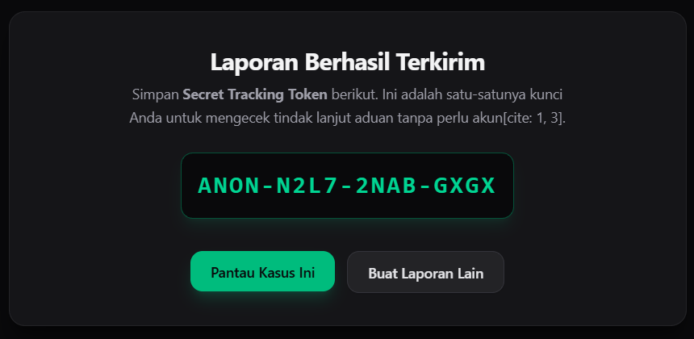

2.

- 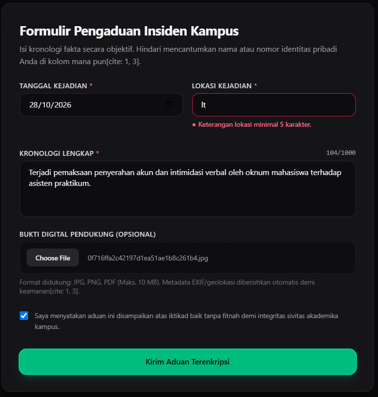

3.

- 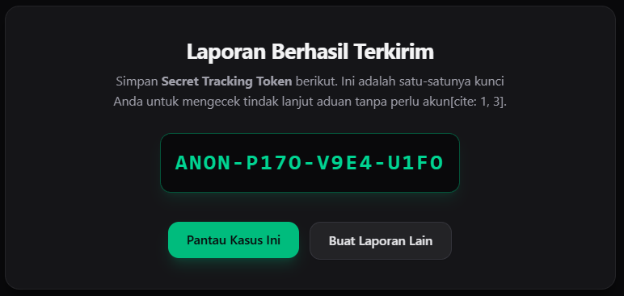

4.

- 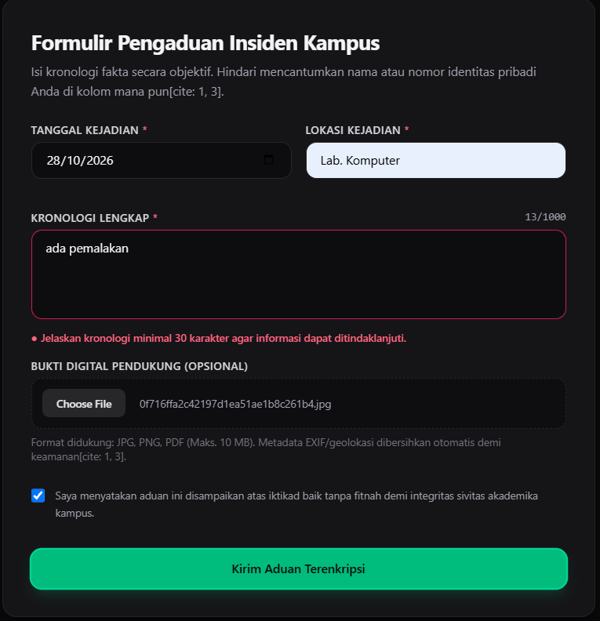

5.

- 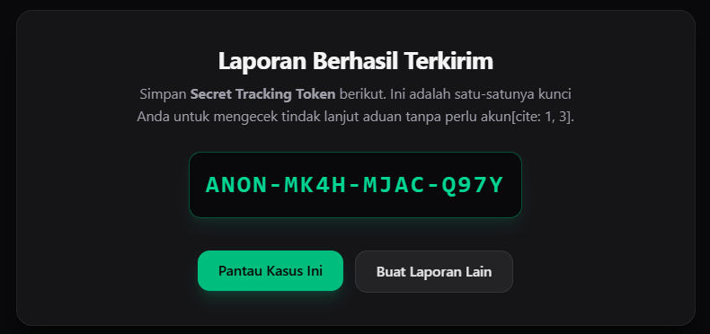

6.

- 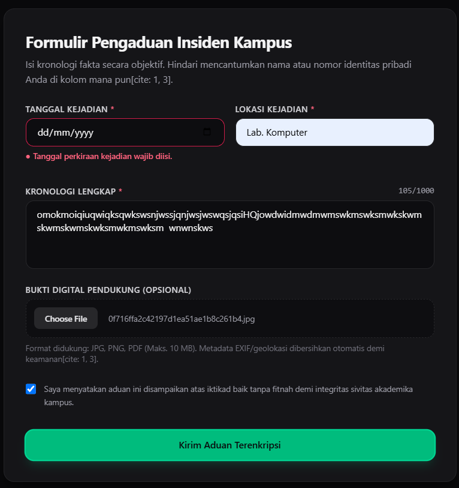

7.

- 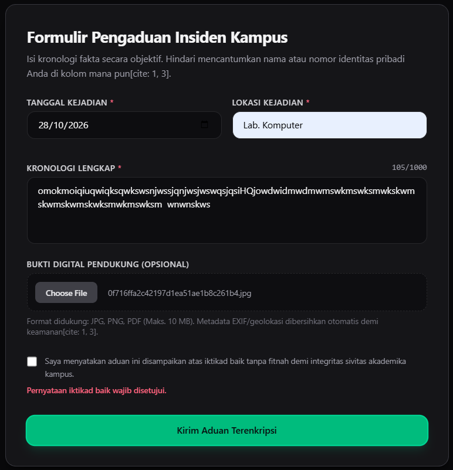

8.

- 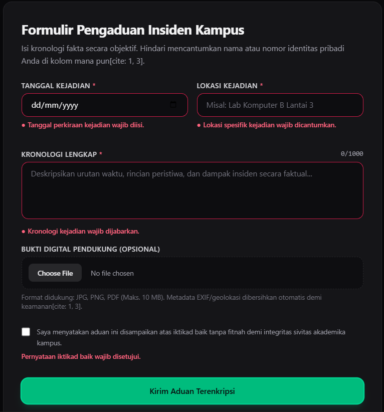

## 4. Session dan Cookie

### Atribut Cookie Sesi dan Alasan Pemilihannya

Pada arsitektur autentikasi pengelola/petugas di AnonPulse, pengelolaan session menggunakan cookie HTTP dengan konfigurasi atribut keamanan ketat sesuai standar modul:

| Atribut Cookie | Nilai Pengaturan                        | Alasan Pemilihan & Ancaman yang Dikurangi                                                                                                                                                                                                                                                      |
| :------------- | :-------------------------------------- | :--------------------------------------------------------------------------------------------------------------------------------------------------------------------------------------------------------------------------------------------------------------------------------------------- |
| `HttpOnly`     | `true`                                  | Mencegah akses nilai cookie dari JavaScript peramban (`document.cookie`), sehingga memitigasi risiko pencurian sesi melalui serangan _Cross-Site Scripting_ (XSS).                                                                                                                             |
| `Secure`       | `process.env.NODE_ENV === "production"` | Memastikan cookie hanya dikirimkan melalui saluran komunikasi terenkripsi HTTPS di lingkungan produksi, melindungi sesi dari intersepsi jaringan (_man-in-the-middle attack_). Pada lingkungan lokal/pengembangan (`localhost`), nilai bernilai `false` agar sesi dapat diuji tanpa SSL lokal. |
| `SameSite`     | `"lax"`                                 | Mencegah cookie dikirimkan secara otomatis pada permintaan lintas situs pihak ketiga (_cross-site requests_), efektif menahan serangan _Cross-Site Request Forgery_ (CSRF) tanpa mengganggu navigasi tautan biasa.                                                                             |
| `Path`         | `"/"`                                   | Menjadikan cookie sesi berlaku di seluruh segmen rute aplikasi yang membutuhkan proteksi pengelola.                                                                                                                                                                                            |
| `Max-Age`      | `28800` (8 jam)                         | Menetapkan masa kedaluwarsa sesi secara deterministik guna membatasi jangka waktu penyalahgunaan jika pengidentifikasi sesi sempat disusupi.                                                                                                                                                   |

### Hasil Uji Penolakan Sesi

Pengujian dilakukan untuk membuktikan keandalan pola session di sisi server:

1. **Uji Cookie Palsu:** Mengubah string token `sesi` di panel DevTools (_Application > Cookies_) menjadi nilai acak buatan. Saat formulir terproteksi dikirim, fungsi `bacaSesi()` di server memeriksa ke dalam memori/penyimpanan dan mendapati token tidak terdaftar, sehingga permintaan ditolak dengan pesan: _"Silakan masuk terlebih dahulu."_
   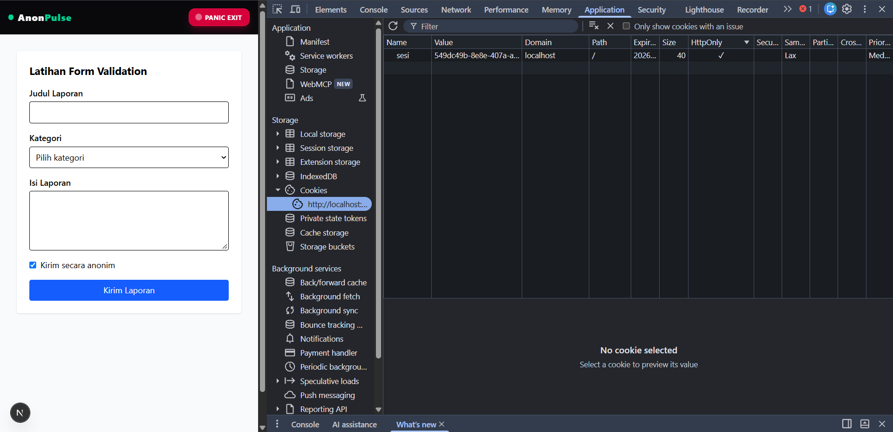
   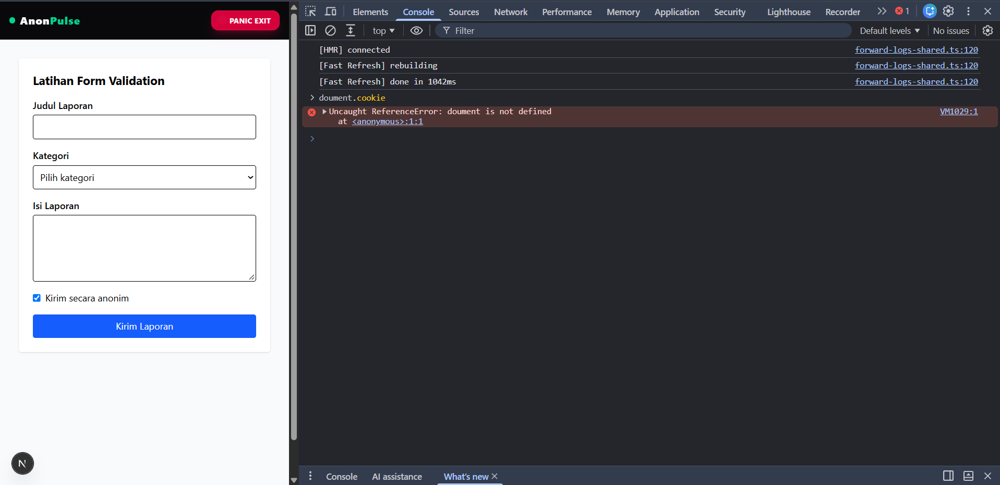
   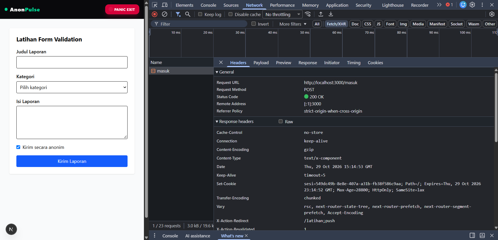
2. **Uji Logout:** Menekan tombol keluar memicu aksi `keluar()`, yang menghapus ID sesi dari penyimpanan memori server sekaligus mengirimkan instruksi penghapusan cookie ke peramban. Pengguna langsung dialihkan ke rute beranda (`/`).
   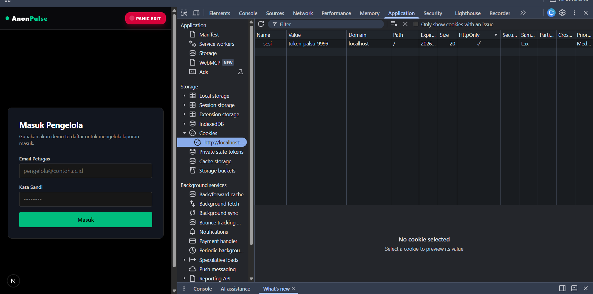
3. **Uji Cookie Lama Setelah Logout:** Menyalin nilai cookie sesi yang sah sebelum logout, lalu menyuntikkannya kembali ke peramban setelah menekan logout. Ketika halaman terproteksi diakses, sistem tetap mengalihkan ke rute login (`/masuk`) karena ID sesi tersebut telah dimusnahkan secara permanen dari penyimpanan server saat aksi logout dieksekusi.
   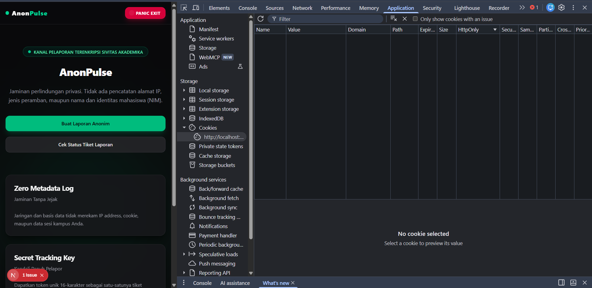

---

## 5. Keputusan Teknis

### Pola Session di Server Dibandingkan Token di Cookie (Stateless JWT)

- **Pencabutan Akses Seketika (_Instant Revocation_):** Pada pola session di server (stateful), identitas sesi disimpan di penyimpanan server (memori/basis data). Jika pengelola menekan tombol logout atau terjadi insiden keamanan, server dapat langsung membatalkan sesi tersebut. Sebaliknya, pada token tanpa status (stateless JWT), token tetap sah secara kriptografis sampai masa kedaluwarsanya habis, kecuali diimplementasikan mekanisme _token blocklist_ rumit yang justru menghilangkan sifat nir-statusnya.
- **Ukuran Muatan Jaringan:** Cookie session hanya memuat string UUID acak berukuran kecil (36 karakter), meminimalkan _overhead_ header HTTP pada setiap permintaan lintas halaman.

### Batas Peran `proxy.ts` Dibandingkan Pemeriksaan di Server Action

- **Peran `proxy.ts` (Pemeriksaan Optimistik):** Berjalan di lapisan perantara sebelum rute dirender. Tugasnya hanya melakukan pemeriksaan cepat di pintu masuk, yakni memeriksa apakah cookie `sesi` ada atau tidak. Jika tidak ada, pengguna langsung dialihkan ke `/masuk` tanpa membuang sumber daya rendering halaman.
- **Peran Verifikasi di Server Action (Pemeriksaan Otoritatif):** `proxy.ts` tidak memeriksa apakah sesi tersebut valid, kedaluwarsa, atau sudah dicabut di server. Oleh karena itu, setiap Server Action yang mengeksekusi mutasi data wajib memanggil `bacaSesi()` secara independen. Ini menjamin keamanan _defense-in-depth_, sehingga penyerang yang memalsukan nilai cookie tetap gagal melakukan tindakan manipulasi data.

## 6. Kendala dan Penyelesaian

Selama implementasi dan pengujian Modul 5 pada aplikasi AnonPulse, beberapa kendala teknis yang dihadapi beserta solusinya meliputi:

1. **Rute `/masuk` Menghasilkan Galat 404 Not Found Saat Pengujian Cookie Awal**
   - _Kendala:_ Halaman login belum diimplementasikan di folder `src/app/masuk/`, sehingga pengujian atribut cookie di panel Application DevTools sempat menampilkan tabel kosong (_No cookie selected_).
   - _Penyelesaian:_ Membuat modul `src/lib/sesi.ts` menggunakan pola _in-memory session map_ di `globalThis`, mengimplementasikan Server Action `masuk()` dan `keluar()` di `src/app/masuk/actions.ts`, serta merender antarmuka `FormMasuk.tsx` di `src/app/masuk/page.tsx`. Kredensial pengelola diamankan melalui variabel lingkungan `.env.local`.

2. **Formulir Mereset Nilai Masukan Pengguna Setelah Validasi Gagal (React 19)**
   - _Kendala:_ React 19 secara otomatis mengatur ulang (_reset_) elemen-elemen formulir yang tidak terkendali (_uncontrolled inputs_) setelah Server Action dieksekusi, yang menyebabkan isian pengguna hilang ketika server mengembalikan galat.
   - _Penyelesaian:_ Mengembalikan objek `nilai` berisi nilai mentah input sebelumnya dari Server Action (`kirimLaporanLatihan`) ke dalam state `useActionState`, kemudian memasangkannya ke atribut `defaultValue={n?.kolom}` pada komponen formulir klien. Pada elemen `<select>`, ditambahkan atribut `key={n?.kategori ?? "awal"}` agar elemen dipaksa dirender ulang dengan nilai yang tepat.

3. **Proteksi Sesi Palsu Sempat Tembus Sebelum Verifikasi Server Terpasang**
   - _Kendala:_ Nilai cookie `sesi` yang dimanipulasi dengan string palsu (`token-palsu-9999`) di DevTools masih menampilkan form latihan tanpa penolakan karena rute halaman belum memeriksa status sesi secara otoritatif.
   - _Penyelesaian:_ Menerapkan pendekatan keamanan berlapis (_defense-in-depth_): membuat `proxy.ts` untuk pengecekan cepat keberadaan cookie di lapisan routing, menambahkan verifikasi `const sesi = await bacaSesi(); if (!sesi) redirect("/masuk");` di tingkat Server Component (`page.tsx`), serta memanggil `await bacaSesi()` di baris teratas Server Action sebelum proses ekstraksi dan validasi masukan dijalankan.

---

## 7. Catatan Pemanfaatan AI

Penyusunan kode dan dokumentasi teknis pada modul ini memanfaatkan asisten kecerdasan artifisial dengan rincian transparansi sebagai berikut:

- **Alat AI yang Digunakan:** Gemini (Large Language Model)
- **Perintah Utama (Prompts):**
  1. _"Saya ingin mengerjakan dokumen teknis sesuai dengan arahan modul. berikan saya langkah2nya secara detail."_
  2. _"Bisa ga tanpa ngelanggar ketentuan modul, uji bukti validasinya yang salah aja?"_
  3. _"Gambar pertama adalah gambar urutan angka terakhir. bisakah anda membuat testing validasinya, soalnya yang udh ada sekarag belum sesuai sama hasilnya"_
- **Bagian yang Dihasilkan dengan Bantuan AI:**
  - Penyesuaian struktur draf dokumen teknis `docs/praktikum/modul-05.md` agar memenuhi rubrik penilaian (35% ketepatan teknis, 30% bukti uji, 20% keputusan teknis, 15% AI log).
  - Pemetaan skenario 8 kasus uji pada tabel validasi agar mencerminkan antarmuka nyata dan pesan galat riil dari sistem AnonPulse (_Formulir Pengaduan Insiden Kampus_).
  - Pembuatan modul session `sesi.ts`, komponen `FormMasuk.tsx`, dan alur `proxy.ts` yang kompatibel dengan Next.js App Router dan React 19.
- **Cara Memverifikasi Hasil AI:**
  - Menjalankan server lokal `npm run dev` dan memeriksa bahwa halaman `/latihan` dan `/masuk` dapat dirender tanpa galat.
  - Memverifikasi atribut cookie (`HttpOnly`, `SameSite=Lax`, `Path=/`) langsung melalui panel DevTools (_Application > Cookies_) dan memastikan `document.cookie` di Console tidak menampilkan token sesi.
  - Menguji penolakan validasi server dengan menambahkan atribut `novalidate` di DevTools untuk memastikan masukan di bawah batas minimal (seperti judul, lokasi, kronologi) benar-benar ditolak dan memunculkan pesan teks galat yang sesuai.
  - Menjalankan `npx tsc --noEmit` dan `npm run lint` untuk memastikan seluruh tipe data TypeScript valid tanpa _type error_.
